[](https://jagdish3135.github.io/knit/)

<p align="center">
  <picture>
    <source media="(prefers-color-scheme: dark)" srcset="docs/readme/banner-dark.svg">
    
  </picture>
</p>

<p align="center">
  <a href="https://lexagent-phi.vercel.app"></a>
  <a href="#-see-it-in-action"></a>
  <a href="sample-cases"></a>
  <a href="docs/readme/sample-report.pdf"></a>
</p>

<p align="center">
  
  
  
  
  
  
  
  
</p>

<p align="center">
  <b><a href="#-see-it-in-action">Demo</a></b> ·
  <b><a href="#-how-it-works">How it works</a></b> ·
  <b><a href="#-meet-the-four-agents">Agents</a></b> ·
  <b><a href="#-three-languages-five-kinds-of-reader">Languages & roles</a></b> ·
  <b><a href="#-the-pdf-report">PDF report</a></b> ·
  <b><a href="#-sample-cases">Sample cases</a></b> ·
  <b><a href="#-run-it-locally">Run locally</a></b> ·
  <b><a href="#-put-it-online-with-your-ai-key-vercel">Deploy</a></b> ·
  <b><a href="#-faq">FAQ</a></b>
</p>

> [!IMPORTANT]
> **Decision support, not a decision.** LexAgent helps people *understand* a case document. It never gives a verdict,
> never replaces an advocate, and every report says so on every page.

---

## 🎬 See it in action

<p align="center">
  <a href="docs/readme/demo.mp4">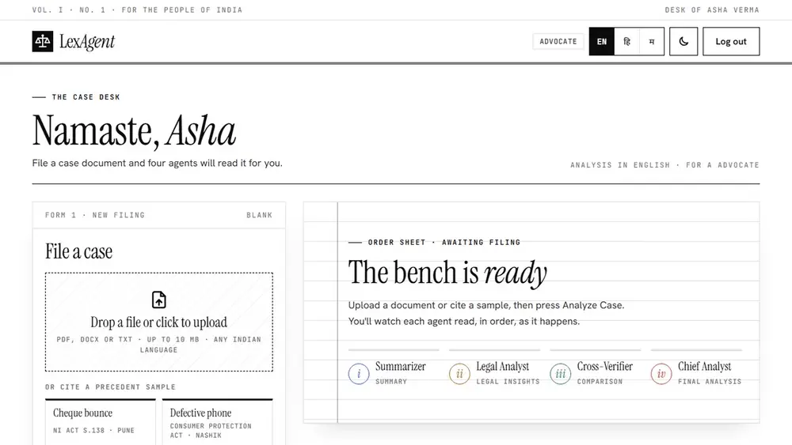</a>
</p>

<p align="center"><b>🌐 Live: <a href="https://lexagent-phi.vercel.app">lexagent-phi.vercel.app</a></b></p>

<p align="center"><sub>▶ <a href="docs/readme/demo.mp4"><b>Watch the full walkthrough in 1080p (MP4)</b></a>: landing page → sign up as an advocate → switch to मराठी → upload a Marathi case file → four agents live → results → PDF export<br>
Preview not moving? <a href="docs/readme/demo.gif">Open the GIF version</a>.</sub></p>

---

## ⚖️ Why LexAgent

India's courts carry a backlog of crores of cases, and almost every one starts with someone reading a long, dense document.
Citizens often can't follow it at all, and lawyers and judges spend hours on the first read alone.

<table>
  <tr>
    <th width="50%">😩 Today</th>
    <th width="50%">✨ With LexAgent</th>
  </tr>
  <tr>
    <td>Read 40 pages of legal language line by line</td>
    <td>A plain-language summary, parties and timeline in about a minute</td>
  </tr>
  <tr>
    <td>Hunt for the Acts and sections that apply</td>
    <td>A table of relevant laws with one line on why each matters, including <b>BNS / BNSS / BSA</b> next to the old IPC / CrPC / Evidence Act</td>
  </tr>
  <tr>
    <td>Trust a single AI answer that may be confidently wrong</td>
    <td>Two agents read independently and a third <b>cross-checks</b> them, with a confidence level</td>
  </tr>
  <tr>
    <td>District-court files in Marathi or Hindi that most tools can't read</td>
    <td>Upload case documents in <b>any Indian language</b>; the agents read them in the original</td>
  </tr>
  <tr>
    <td>Legal English only</td>
    <td>The whole analysis in <b>English, हिन्दी or मराठी</b>, pitched for a citizen, student, advocate, judge or researcher</td>
  </tr>
  <tr>
    <td>Copy notes into a document by hand</td>
    <td>One click gives you a <b>branded PDF report</b> to share</td>
  </tr>
</table>

---

## 🔄 How it works

<p align="center">
  <picture>
    <source media="(prefers-color-scheme: dark)" srcset="docs/readme/pipeline-dark.svg">
    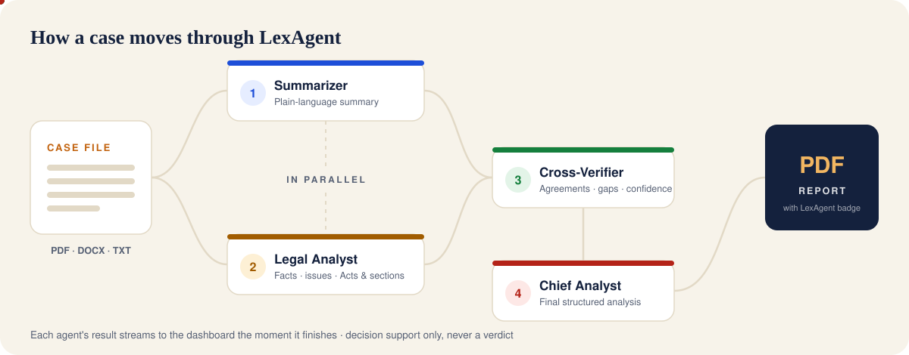
  </picture>
</p>

1. **Upload**: drop a PDF, DOCX or TXT file, paste text, or pick a sample. Text is extracted **in your browser**, so the file itself is never uploaded. Scanned PDFs, and Hindi/Marathi PDFs with a broken text layer, are read with **OCR** (Marathi, Hindi and English), also in the browser.
2. **Read in parallel**: the **Summarizer** and the **Legal Analyst** read the same case independently.
3. **Cross-check**: the **Cross-Verifier** compares both readings against the case text and flags gaps.
4. **Conclude**: the **Chief Analyst** combines everything into a final structured analysis.
5. **Export**: download the whole thing as a graphical PDF, in the language you chose.

<details>
<summary><b>🔍 Show the request, step by step (sequence diagram)</b></summary>
<br>

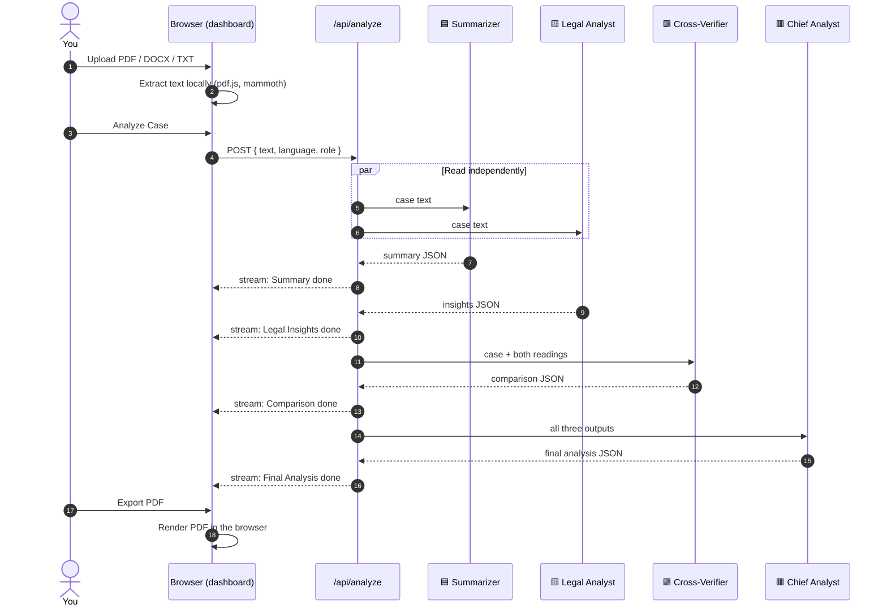

</details>

---

## 🤖 Meet the four agents

| | Agent | Job | You get |
|:-:|---|---|---|
| 🟦 | **Summarizer** | Explains the case so anyone can follow it | Plain-language summary · parties · timeline |
| 🟨 | **Legal Analyst** | Reads it like a lawyer | Key facts · issues for the court · each side's arguments · Acts and sections |
| 🟩 | **Cross-Verifier** | Compares the two readings with each other and with the text | Agreements · differences · inconsistencies · confidence |
| 🟥 | **Chief Analyst** | Writes the final brief, dropping anything the verifier could not confirm | Overview · key findings · strengths and weaknesses · open questions · next steps |

Every agent follows the same ground rules: stay grounded in the document, never invent citations, never deliver a verdict,
know the 2024 criminal-law change (BNS replaced the IPC, BNSS the CrPC, BSA the Evidence Act), treat the document as data,
not instructions, and write for the reader's role and language.

<details>
<summary><b>🧩 Show what each agent returns (JSON shapes)</b></summary>
<br>

Each agent answers in strict JSON, validated with [zod](https://zod.dev). A missing field becomes an empty value instead of failing the whole analysis.

```jsonc
// 🟦 Summarizer
{ "title": "", "caseType": "", "court": "", "plainSummary": [""], "parties": [{ "name": "", "role": "" }], "timeline": [{ "date": "", "event": "" }] }

// 🟨 Legal Analyst
{ "keyFacts": [""], "issues": [""], "arguments": [{ "side": "", "points": [""] }], "laws": [{ "law": "", "section": "", "relevance": "" }] }

// 🟩 Cross-Verifier
{ "agreements": [""], "differences": [""], "inconsistencies": [""], "confidence": "High | Medium | Low", "confidenceNote": "" }

// 🟥 Chief Analyst
{ "overview": "", "keyFindings": [""], "sides": [{ "side": "", "strengths": [""], "weaknesses": [""] }], "openQuestions": [""], "nextSteps": [""] }
```

The prompts live in [`src/lib/agents.ts`](src/lib/agents.ts) and the schemas in [`src/lib/schemas.ts`](src/lib/schemas.ts).

</details>

---

## 🌐 Local-language cases, three interface languages, five kinds of reader

**Case documents in the court's own language.** District courts in India often work in the local language. LexAgent's
agents read case files written in **Marathi, Hindi, Gujarati, Bengali, Tamil, Telugu, Kannada, Malayalam, Punjabi, Odia,
Urdu, English or a mix**, in the original, and say which language the document is in.

**Answers in your language.** Switch **EN · हि · म** from any page: the interface, the four agents' output and the PDF
report all follow, whatever language the case file is in. At sign-up you pick who you are, and the agents adjust their
depth and tone.

<table>
  <tr>
    <td width="58%">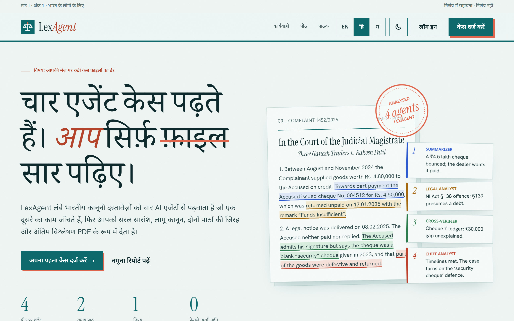</td>
    <td width="42%">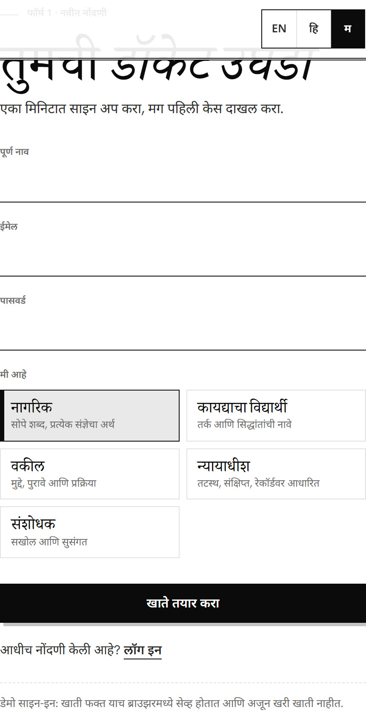</td>
  </tr>
  <tr>
    <td align="center"><sub>Landing page in हिन्दी</sub></td>
    <td align="center"><sub>Sign-up in मराठी with the role picker</sub></td>
  </tr>
</table>

| Role | How the agents write for you |
|---|---|
| 🧑 **Citizen** | Very simple words; every legal term explained the first time |
| 🎓 **Law student** | The legal reasoning, with doctrines and presumptions named |
| 💼 **Advocate** | Precise and concise; issues, evidence on record and procedure |
| ⚖️ **Judge** | Neutral and concise; issues, evidence on record and applicable law |
| 🔎 **Researcher** | Thorough and well structured |

> [!NOTE]
> Names of Acts, section numbers and party names stay as they appear in the document, so they can be checked against the record.
> **Scanned and broken Hindi/Marathi PDFs:** many court PDFs are scans, or have a broken text layer (the page looks fine,
> but the extracted text is scrambled). LexAgent detects both and reads the page images with **OCR** in your browser,
> then asks you to check the text before analysing. Nothing is uploaded for OCR.

---

## 📄 The PDF report

One click on **Export PDF report** builds a real PDF in your browser: selectable text, not a screenshot. It has the
LexAgent seal, a coloured section for each agent, a confidence stamp, a timeline, a laws table, page numbers, and the
disclaimer on every page. Hindi and Marathi reports embed a Devanagari font.

<table>
  <tr>
    <td width="25%"><a href="docs/readme/sample-report.pdf">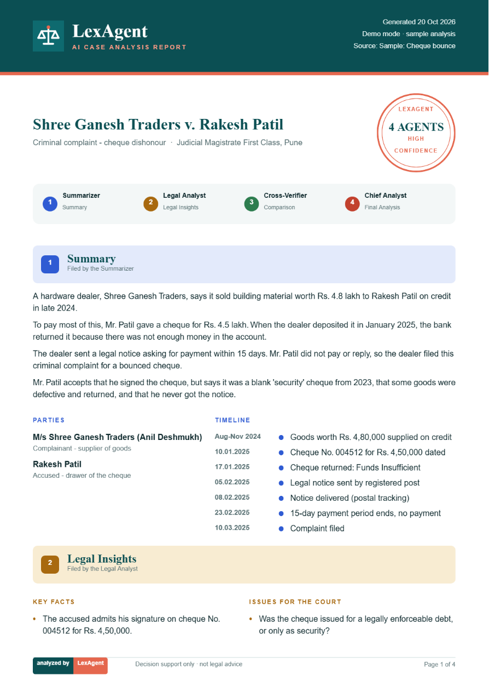</a></td>
    <td width="25%"><a href="docs/readme/sample-report.pdf">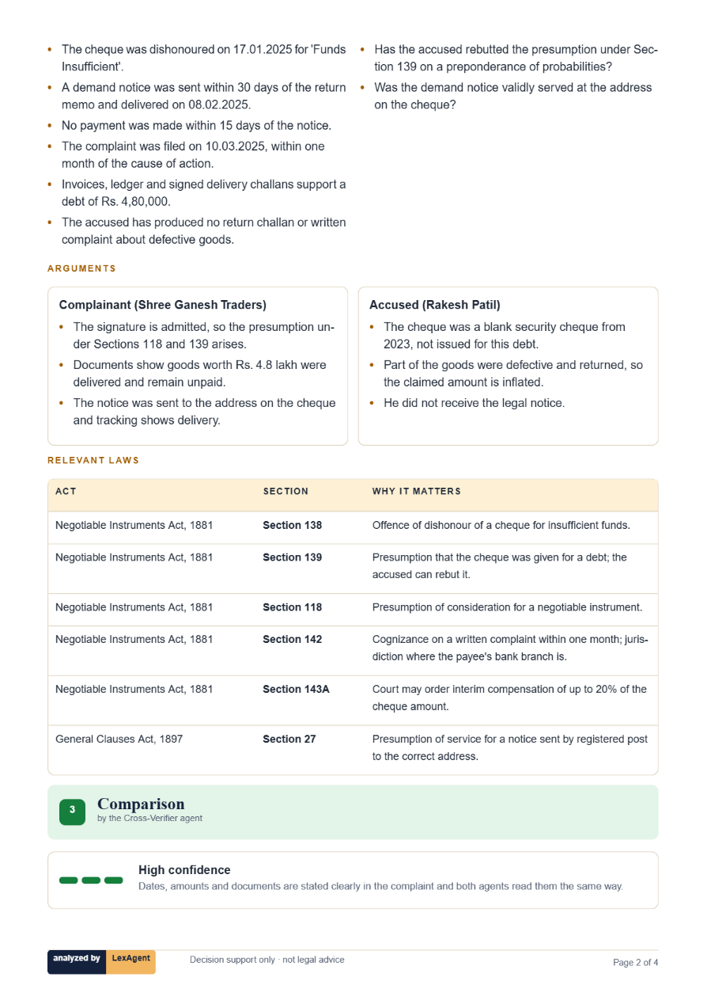</a></td>
    <td width="25%"><a href="docs/readme/sample-report.pdf">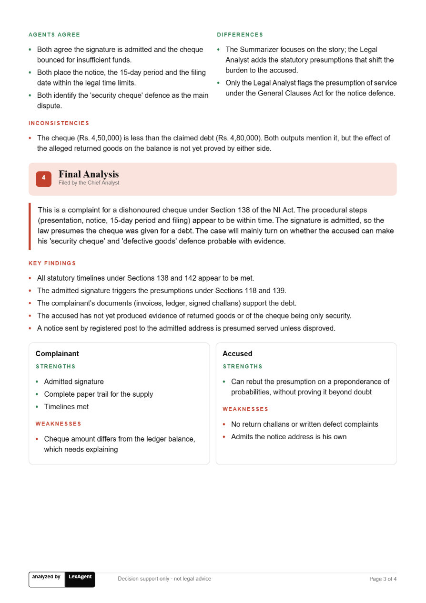</a></td>
    <td width="25%"><a href="docs/readme/sample-report-hi.pdf">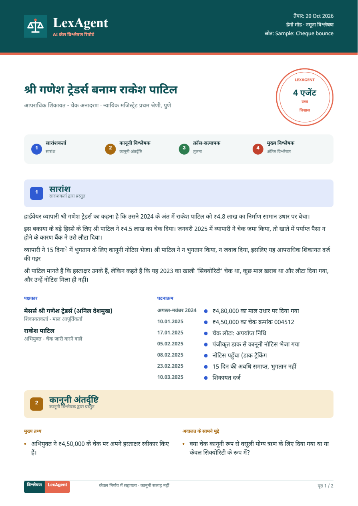</a></td>
  </tr>
  <tr>
    <td align="center"><sub>Cover, seal and summary</sub></td>
    <td align="center"><sub>Insights and laws table</sub></td>
    <td align="center"><sub>Cross-check and final analysis</sub></td>
    <td align="center"><sub>हिन्दी report</sub></td>
  </tr>
</table>

<p align="center"><a href="docs/readme/sample-report.pdf"><b>📄 Open the English sample report</b></a> · <a href="docs/readme/sample-report-hi.pdf"><b>हिन्दी नमूना रिपोर्ट</b></a></p>

---

## 📂 Sample cases

The [`sample-cases/`](sample-cases) folder has seven **fictional** Indian case documents, in **English, Marathi and Hindi**,
so you can try the upload straight away. On the live site the same files are linked under *Download sample case files*
on the dashboard.

| Case | Language | Law | Files |
|---|---|---|---|
| Cheque bounce, Pune | English | NI Act, 1881 · s.138 | [PDF](sample-cases/01-cheque-bounce-ni-act.pdf) · [DOCX](sample-cases/01-cheque-bounce-ni-act.docx) · [TXT](sample-cases/01-cheque-bounce-ni-act.txt) |
| Defective phone, Nashik | English | Consumer Protection Act, 2019 | [PDF](sample-cases/02-defective-phone-consumer.pdf) · [DOCX](sample-cases/02-defective-phone-consumer.docx) · [TXT](sample-cases/02-defective-phone-consumer.txt) |
| Job-offer fraud bail, Nagpur | English | BNS s.318(4) · BNSS s.480 | [PDF](sample-cases/03-job-fraud-cheating-bns.pdf) · [DOCX](sample-cases/03-job-fraud-cheating-bns.docx) · [TXT](sample-cases/03-job-fraud-cheating-bns.txt) |
| Tenant eviction, Mumbai | English | Maharashtra Rent Control Act, 1999 | [PDF](sample-cases/04-tenant-eviction-rent-act.pdf) · [DOCX](sample-cases/04-tenant-eviction-rent-act.docx) · [TXT](sample-cases/04-tenant-eviction-rent-act.txt) |
| Road accident claim, Kolhapur | English | Motor Vehicles Act, 1988 · s.166 | [PDF](sample-cases/05-motor-accident-claim.pdf) · [DOCX](sample-cases/05-motor-accident-claim.docx) · [TXT](sample-cases/05-motor-accident-claim.txt) |
| शेतरस्ता मनाई हुकूम, वडूज (सातारा) | **मराठी** | Easements Act s.15 · Specific Relief Act s.38–39 · MLRC s.143 | [PDF (scan)](sample-cases/06-farm-road-injunction-marathi.pdf) · [DOCX](sample-cases/06-farm-road-injunction-marathi.docx) · [TXT](sample-cases/06-farm-road-injunction-marathi.txt) |
| भरण-पोषण, कुटुंब न्यायालय भोपाल | **हिन्दी** | BNSS s.144 | [PDF (scan)](sample-cases/07-maintenance-hindi.pdf) · [DOCX](sample-cases/07-maintenance-hindi.docx) · [TXT](sample-cases/07-maintenance-hindi.txt) |

> [!TIP]
> The Marathi and Hindi PDFs are **image-only scans**, like real court copies: upload one to watch the OCR read it page by page.
>
> **Demo mode is honest.** Without an AI key, LexAgent recognises these sample files (as PDF, DOCX or TXT) and shows their
> stored analysis. For any other document it says it can't analyse it in demo mode, instead of showing a different case.

---|---|---|
| Cheque bounce, Pune | NI Act, 1881 · s.138 | [PDF](sample-cases/01-cheque-bounce-ni-act.pdf) · [DOCX](sample-cases/01-cheque-bounce-ni-act.docx) · [TXT](sample-cases/01-cheque-bounce-ni-act.txt) |
| Defective phone, Nashik | Consumer Protection Act, 2019 | [PDF](sample-cases/02-defective-phone-consumer.pdf) · [DOCX](sample-cases/02-defective-phone-consumer.docx) · [TXT](sample-cases/02-defective-phone-consumer.txt) |
| Job-offer fraud, Nagpur | BNS s.318(4) · BNSS s.480 (bail) | [PDF](sample-cases/03-job-fraud-cheating-bns.pdf) · [DOCX](sample-cases/03-job-fraud-cheating-bns.docx) · [TXT](sample-cases/03-job-fraud-cheating-bns.txt) |
| Tenant eviction, Mumbai | Maharashtra Rent Control Act, 1999 | [PDF](sample-cases/04-tenant-eviction-rent-act.pdf) · [DOCX](sample-cases/04-tenant-eviction-rent-act.docx) · [TXT](sample-cases/04-tenant-eviction-rent-act.txt) |
| Road accident claim, Kolhapur | Motor Vehicles Act, 1988 · s.166 | [PDF](sample-cases/05-motor-accident-claim.pdf) · [DOCX](sample-cases/05-motor-accident-claim.docx) · [TXT](sample-cases/05-motor-accident-claim.txt) |

---

## 🖥 Screens

<details open>
<summary><b>Landing page</b> (follows your GitHub theme)</summary>
<br>
<picture>
  <source media="(prefers-color-scheme: dark)" srcset="docs/readme/landing-dark.jpg">
  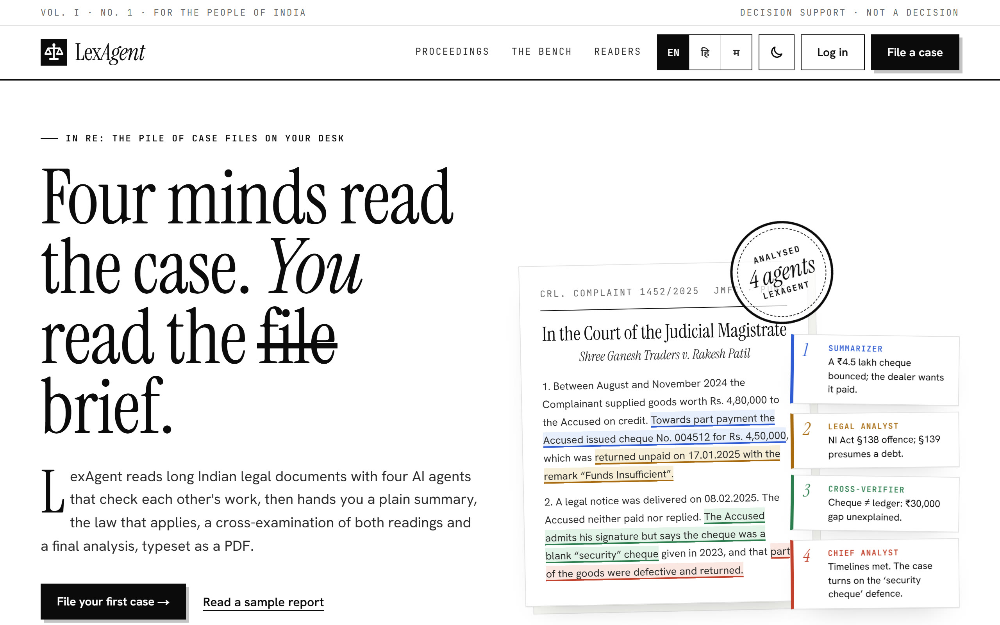
</picture>
</details>

<details open>
<summary><b>Dashboard after an analysis</b>: light and dark</summary>
<br>
<table>
  <tr>
    <td width="50%">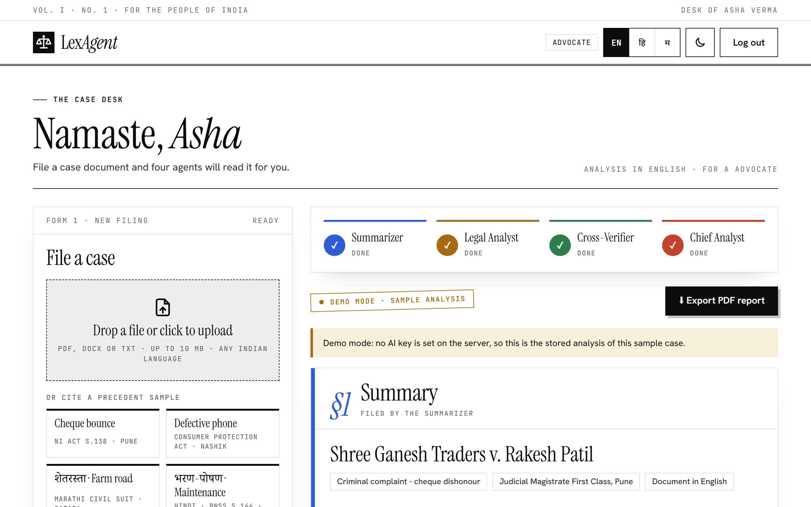</td>
    <td width="50%">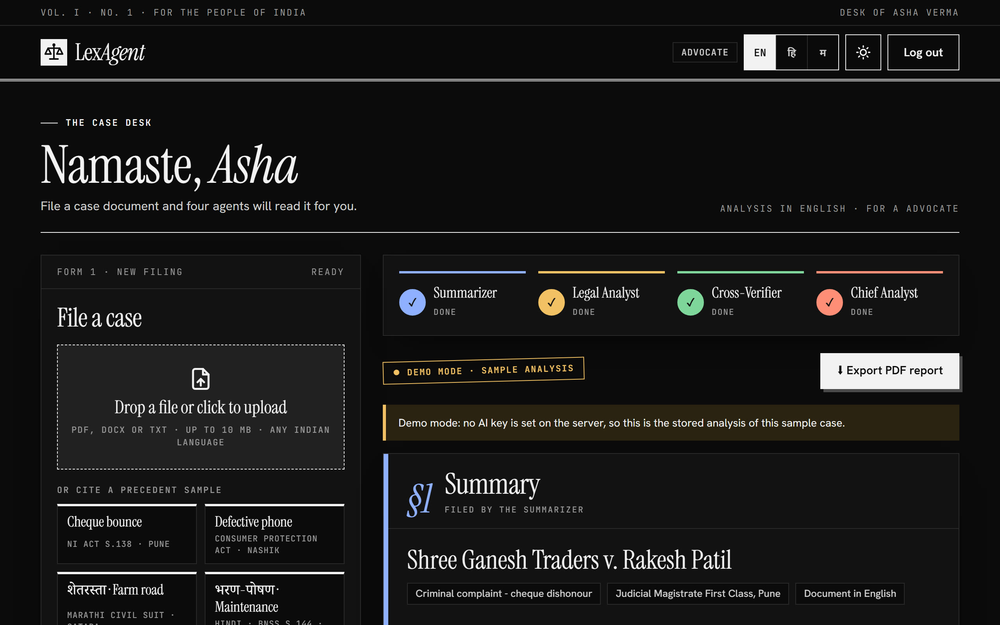</td>
  </tr>
  <tr>
    <td width="50%">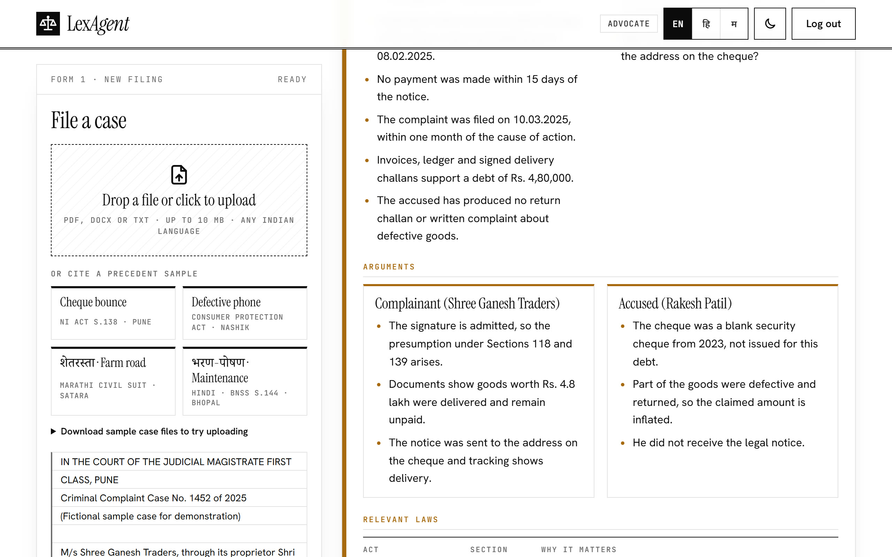</td>
    <td width="50%">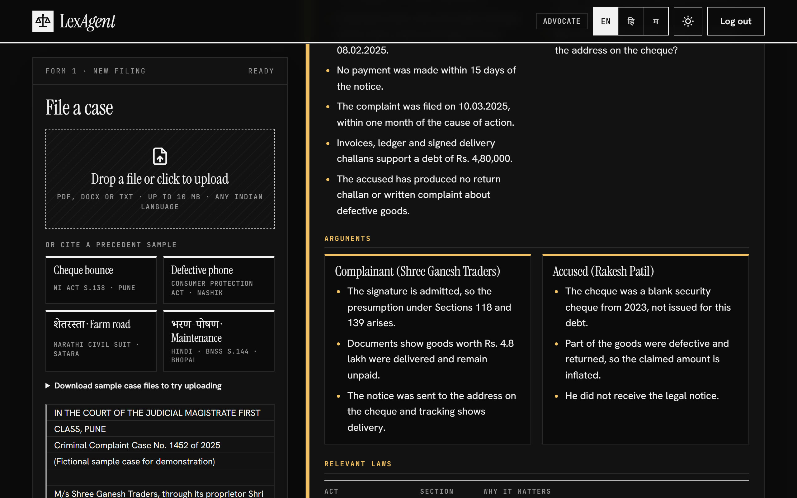</td>
  </tr>
</table>
</details>

<details>
<summary><b>📱 On a phone</b></summary>
<br>
<p align="center">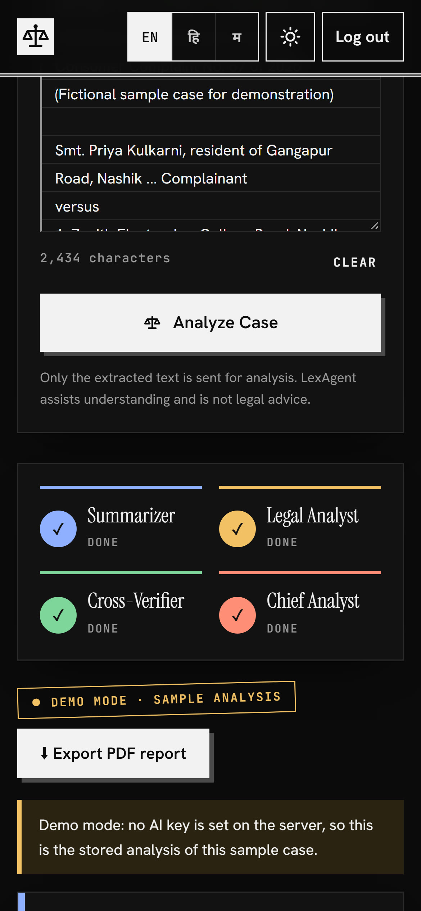</p>
</details>

---

## 🚀 Run it locally

You need **Node.js 20+**. No API key is needed to try it: without one, LexAgent runs in **demo mode** using the sample cases.

```bash
git clone https://github.com/jagdish3135/lexagent.git
```

```bash
cd lexagent && npm install
```

```bash
cp .env.example .env.local
```

Open `.env.local` and paste your own key after `LLM_API_KEY=` (leave it empty for demo mode). Never put the key in `.env.example`, which is committed. Then:

```bash
npm run dev
```

Open http://127.0.0.1:3000, create an account, pick **Cheque bounce** and press **Analyze Case**.

<details>
<summary><b>🔑 Use a free AI provider (Mistral, Groq, Gemini…)</b></summary>
<br>

LexAgent talks to any **OpenAI-compatible** chat API. Pick one and set three variables:

| Provider | `LLM_BASE_URL` | `LLM_MODEL` | Free tier |
|---|---|---|---|
| **Mistral** (default) | `https://api.mistral.ai/v1` | `mistral-small-latest` | Yes ("Experiment" plan) |
| **Groq** | `https://api.groq.com/openai/v1` | `llama-3.3-70b-versatile` | Yes, very fast |
| **Google Gemini** | `https://generativelanguage.googleapis.com/v1beta/openai` | `gemini-2.5-flash` | Yes; prompts may be used for training |
| **OpenRouter** | `https://openrouter.ai/api/v1` | any `:free` model | Yes, low daily cap |

> [!WARNING]
> Legal documents are sensitive. Check your provider's data policy, because some free tiers use prompts to train models.
> The key stays on the server and is never sent to the browser.

`MAX_INPUT_CHARS` (default 40,000) caps how much text the agents read, so free-tier token limits are respected.

</details>

<details>
<summary><b>🧪 Tests, lint and build</b></summary>
<br>

```bash
npm test
```

```bash
npm run lint && npm run typecheck && npm run build
```

The tests cover every sample file (PDF, DOCX and TXT) being recognised as the right case, OCR of the scanned Marathi and Hindi pages, broken Devanagari PDF text being detected, the JSON parsing of model replies, retries on rate limits, zero-quota keys, the agent order (two in parallel,
then the verifier, then the chief), the reader's role and language reaching every agent, skipping downstream agents when
one fails, API input validation, demo-mode streaming and the PDF text sanitizer.

</details>

---

## ☁️ Put it online with your AI key (Vercel)

The live site runs in **demo mode** until a key is added. The key is a secret: add it in Vercel's dashboard, never in the code.

<details open>
<summary><b>Step by step</b></summary>
<br>

1. **Get a key with quota.** In the [Mistral console](https://console.mistral.ai), open your workspace's plan or billing page and
   choose the free **Experiment** plan (it asks you to verify a phone number). Then open **API Keys**, create a new key and copy it.
   A key on a workspace without a plan has **0 requests per minute**, and LexAgent will say *"This AI key has no quota yet"*.
2. **Open the project in Vercel.** Go to [vercel.com/dashboard](https://vercel.com/dashboard) → **lexagent** → **Settings** → **Environment Variables**.
3. **Add the key.** Click **Add New**:
   - **Key**: `LLM_API_KEY`
   - **Value**: paste the key
   - **Environments**: tick **Production** (and **Preview** if you want preview deployments to use it)
   - Turn on **Sensitive**, so the value can't be read back later
   - Click **Save**
4. **Check the other three variables** are there (they are already set for this project):
   `LLM_BASE_URL` = `https://api.mistral.ai/v1`, `LLM_MODEL` = `mistral-small-latest`, `MAX_INPUT_CHARS` = `40000`.
   To switch provider, change these two URLs/models using the table above, and use that provider's key.
5. **Redeploy.** Environment variables only apply to new deployments: **Deployments** → the latest one → **⋯** → **Redeploy**.
6. **Test it.** Open the site, analyze a sample case, and check the badge says **● Live AI · mistral-small-latest** instead of *Demo mode*.

From a terminal instead (in the project folder, logged in with `npx vercel login`):

```bash
npx vercel env add LLM_API_KEY production
```

```bash
npx vercel deploy --prod
```

The first command asks you to paste the key, so it never appears in the command itself or your shell history.

</details>

---

## 🏗 Architecture

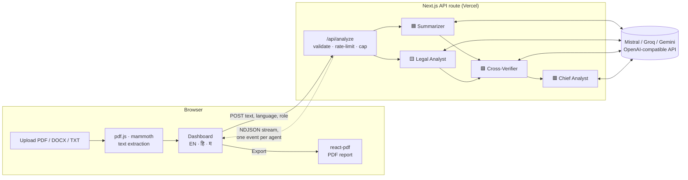

<details>
<summary><b>📁 Project structure</b></summary>
<br>

```text
src/
├─ app/
│  ├─ page.tsx               Landing page
│  ├─ login/ · signup/       Demo auth with role picker (stored in this browser only)
│  ├─ dashboard/page.tsx     Upload, live agent progress, results, export
│  └─ api/analyze/route.ts   Streams the four agents as NDJSON
├─ components/               Logo, language switch, theme toggle, case-file hero, result cards
└─ lib/
   ├─ agents.ts              Prompts + pipeline (2 parallel → verifier → chief), reader role and language
   ├─ llm.ts                 OpenAI-compatible client with retry/backoff
   ├─ schemas.ts             zod schemas for every agent's JSON
   ├─ i18n.ts · locale.ts    English, Hindi and Marathi strings; languages and roles
   ├─ demo.ts · samples.ts   Demo mode and the in-app sample cases
   ├─ extract.ts · pdf-text.ts  Browser-side PDF/DOCX/TXT extraction; broken-Devanagari detection
   ├─ ocr.ts                 In-browser OCR (tesseract.js: Marathi, Hindi, English) for scans
   └─ pdf/                   Graphical PDF report (react-pdf, Devanagari font for hi/mr)
sample-cases/                Seven fictional case files in English, Marathi and Hindi (npm run samples)
docs/readme/                 Everything you see in this README, plus the scripts that make it
```

</details>

<details>
<summary><b>🔌 API: <code>POST /api/analyze</code></b></summary>
<br>

Request: `{ "text": "<case text, at least 200 characters>", "language": "en | hi | mr", "role": "citizen | student | advocate | judge | researcher" }`

The response is `application/x-ndjson`, one JSON event per line, so the UI can update as each agent finishes:

```json
{"type":"meta","mode":"live","model":"mistral-small-latest","truncated":false,"chars":2776}
{"type":"status","agent":"summarizer","status":"working"}
{"type":"status","agent":"analyst","status":"working"}
{"type":"status","agent":"summarizer","status":"done","output":{"title":"…"}}
{"type":"status","agent":"analyst","status":"done","output":{"keyFacts":["…"]}}
{"type":"status","agent":"verifier","status":"working"}
{"type":"status","agent":"verifier","status":"done","output":{"confidence":"High"}}
{"type":"status","agent":"chief","status":"working"}
{"type":"status","agent":"chief","status":"done","output":{"overview":"…"}}
{"type":"end"}
```

Errors: `400` (bad JSON or under 200 characters), `413` (over 400,000 characters), `429` (too many analyses from one IP in 10 minutes).

</details>

---

## 🛡 Privacy and safety

- 📄 **Files stay on your device.** Only the extracted text is sent for analysis; OCR also runs in your browser.
- 🔑 **The AI key lives on the server** (an environment variable) and never reaches the browser.
- 🧱 **Strict Content-Security-Policy**: the browser can only talk to LexAgent itself.
- 🧠 **Prompt-injection guard**: the case text is fenced and treated as data, not instructions.
- 🚦 **Rate limit** per IP, and an input cap to protect free-tier quotas.
- ⚖️ **Disclaimers** on the landing page, the dashboard, every result and every PDF page, in every language.

---

## 🗺 Roadmap

- [x] Upload PDF / DOCX / TXT with in-browser extraction
- [x] OCR for scanned PDFs and Hindi/Marathi PDFs with broken text layers
- [x] Four-agent pipeline with live streaming progress
- [x] Graphical PDF export with the LexAgent seal
- [x] Case documents in any Indian language; interface and answers in English, Hindi and Marathi
- [x] Answers tuned to the reader's role
- [x] Light and dark themes, phone-friendly layout
- [x] Works with free AI providers, plus a demo mode and sample case files
- [ ] Real accounts and saved case history (the current sign-in is a demo)
- [ ] Long judgments: chunked reading beyond the input cap
- [ ] More Indian languages

---

## ❓ FAQ

<details>
<summary><b>Does LexAgent decide who wins?</b></summary>
<br>
No. It lays out facts, issues, arguments and the relevant law, and it lists strengths and weaknesses for each side. It never predicts or delivers a verdict.
</details>

<details>
<summary><b>Is the sign-in real?</b></summary>
<br>
Not yet. Accounts are stored only in your browser, with hashed passwords, so anyone can try the full flow. Real authentication is on the roadmap.
</details>

<details>
<summary><b>Why do I see "Demo mode", or "Demo mode can only analyse the sample cases"?</b></summary>
<br>
No AI key with quota is set on the server. LexAgent then shows the stored analysis of a recognised sample case so the whole flow still works, and refuses other documents rather than showing the wrong case. Follow <a href="#-put-it-online-with-your-ai-key-vercel">the Vercel steps</a> to switch to live AI.
</details>

<details>
<summary><b>It says "This AI key has no quota yet"</b></summary>
<br>
The provider accepted the key but allows 0 requests. For Mistral, activate the free Experiment plan in the console (step 1 above), then try again.
</details>

<details>
<summary><b>Can it read Marathi or Hindi court documents?</b></summary>
<br>
Yes, as PDF, Word (.docx) or text, or pasted text; the agents read them in the original language. Scanned PDFs and Hindi/Marathi PDFs with a broken text layer are read with OCR in your browser (Marathi, Hindi and English models, up to 30 pages), and you are asked to check the text before analysing.
</details>

<details>
<summary><b>Can it read scanned court orders?</b></summary>
<br>
Yes. When a PDF has no text layer, LexAgent renders each page and reads it with OCR (tesseract.js) right in the browser, showing progress page by page. Clear scans work best; check the extracted text before you analyse it.
</details>

<details>
<summary><b>Are the sample cases real?</b></summary>
<br>
No. All of them are fictional, written to show how the agents handle criminal complaints, bail, consumer, tenancy, accident-claim, Marathi civil and Hindi family-court cases.
</details>

---

<p align="center">
  <br>
  <b>LexAgent</b>: understand the law, one case at a time.<br>
  <sub>Made in India 🇮🇳 for citizens, students, lawyers and judges · Not legal advice</sub>
</p>
