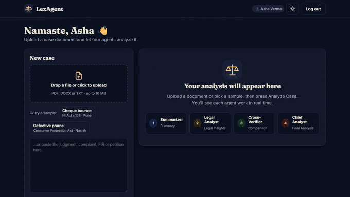
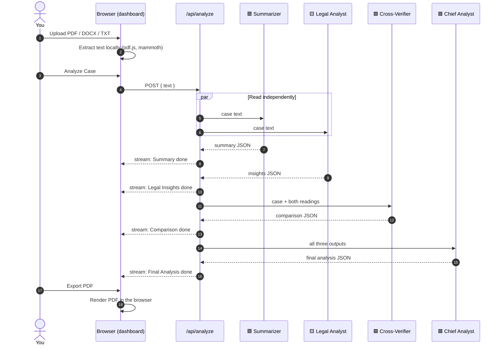
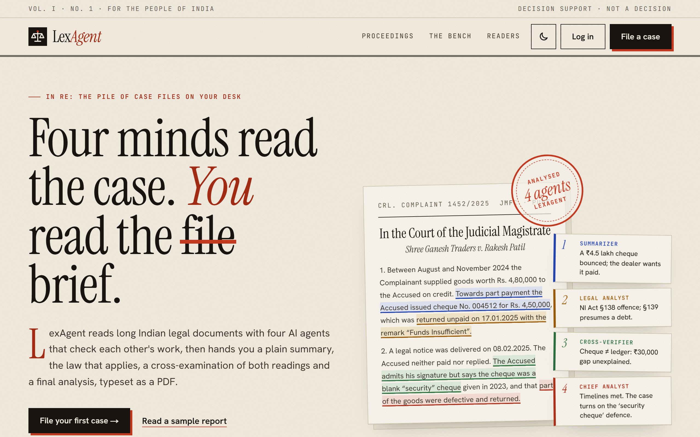
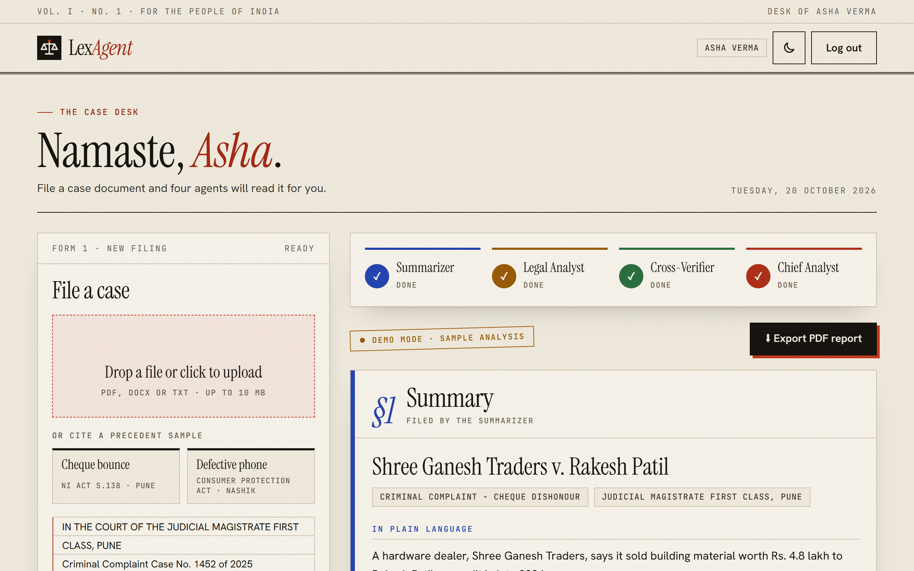
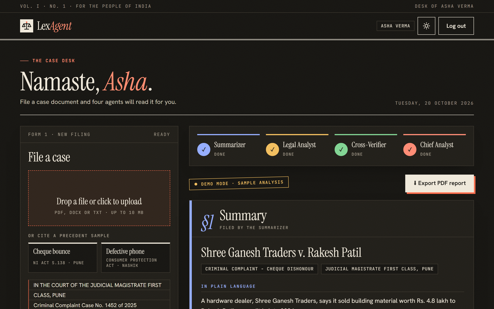
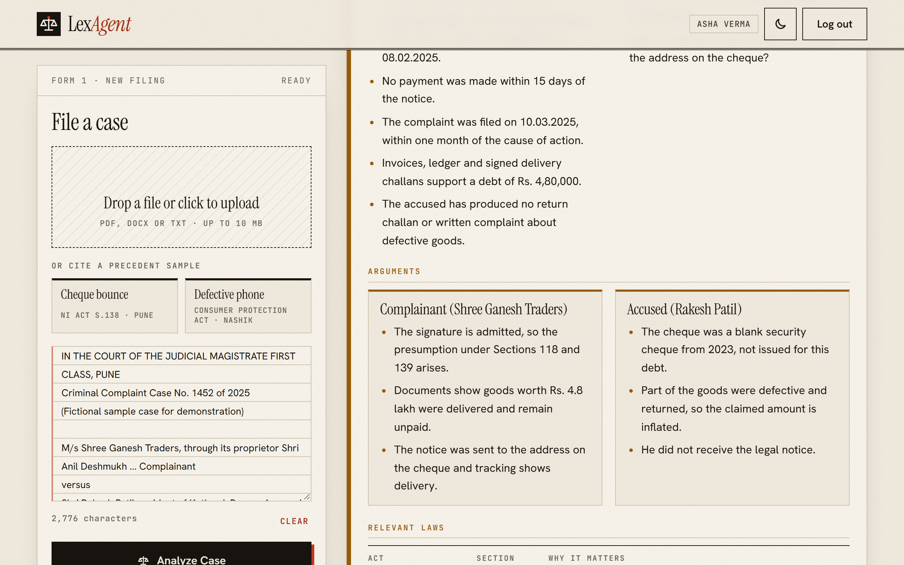
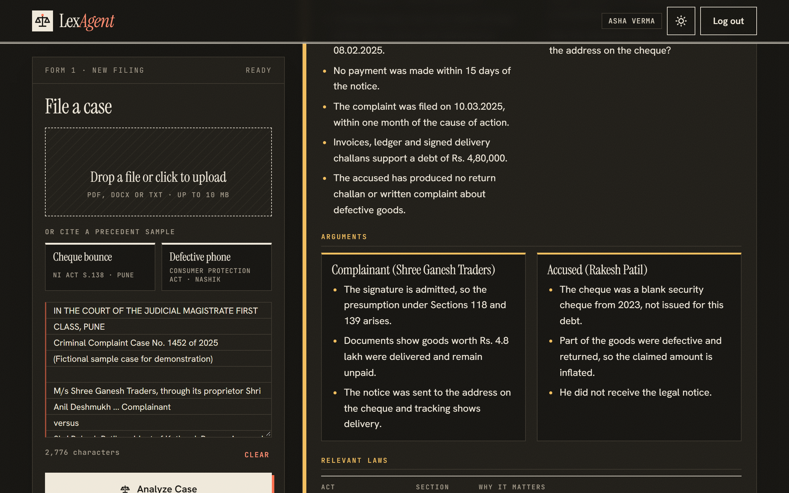
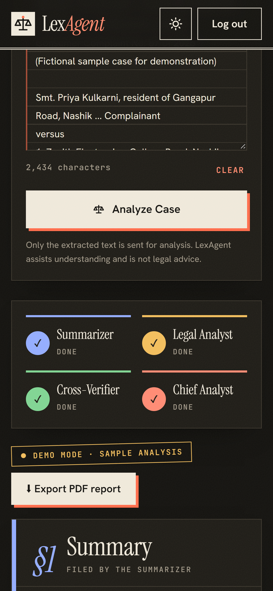
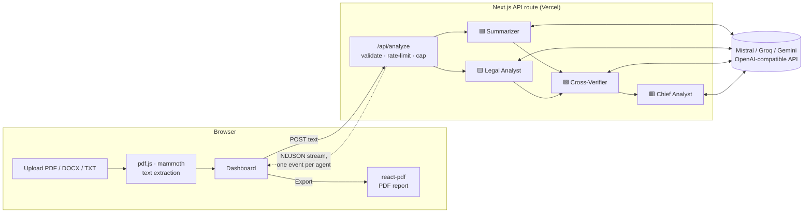

[](https://jagdish3135.github.io/knit/)

<p align="center">
  <picture>
    <source media="(prefers-color-scheme: dark)" srcset="docs/readme/banner-dark.svg">
    
  </picture>
</p>

<p align="center">
  <a href="#-see-it-in-action"></a>
  <a href="#-run-it-locally"></a>
  <a href="docs/readme/sample-report.pdf"></a>
</p>

<p align="center">
  
  
  
  
  
</p>

<p align="center">
  <b><a href="#-see-it-in-action">Demo</a></b> ·
  <b><a href="#-how-it-works">How it works</a></b> ·
  <b><a href="#-meet-the-four-agents">Agents</a></b> ·
  <b><a href="#-the-pdf-report">PDF report</a></b> ·
  <b><a href="#-screens">Screens</a></b> ·
  <b><a href="#-run-it-locally">Run locally</a></b> ·
  <b><a href="#-faq">FAQ</a></b>
</p>

> [!IMPORTANT]
> **Decision support, not a decision.** LexAgent helps people *understand* a case document. It never gives a verdict,
> never replaces an advocate, and every report says so on every page.

---

## 🎬 See it in action

<p align="center">
  <a href="docs/readme/demo.mp4"></a>
</p>

<p align="center"><sub>▶ <a href="docs/readme/demo.mp4"><b>Watch the full 30-second walkthrough (MP4)</b></a>: landing page → sign up → sample case → four agents live → results → PDF export</sub></p>

---

## ⚖️ Why LexAgent

India's courts carry a backlog of millions of cases, and almost every one starts with someone reading a long, dense document.
Citizens often can't follow it at all, and lawyers and judges spend hours on the first read alone.

<table>
  <tr>
    <th width="50%">😩 Today</th>
    <th width="50%">✨ With LexAgent</th>
  </tr>
  <tr>
    <td>Read 40 pages of legal language line by line</td>
    <td>A plain-language summary, parties and timeline in about a minute</td>
  </tr>
  <tr>
    <td>Hunt for the Acts and sections that apply</td>
    <td>A table of relevant laws with one line on why each matters, including <b>BNS / BNSS / BSA</b> next to the old IPC / CrPC / Evidence Act</td>
  </tr>
  <tr>
    <td>Trust a single AI answer that may be confidently wrong</td>
    <td>Two agents read independently and a third <b>cross-checks</b> them, with a confidence level</td>
  </tr>
  <tr>
    <td>Copy notes into a document by hand</td>
    <td>One click gives you a <b>branded PDF report</b> to share</td>
  </tr>
</table>

---

## 🔄 How it works

<p align="center">
  <picture>
    <source media="(prefers-color-scheme: dark)" srcset="docs/readme/pipeline-dark.svg">
    
  </picture>
</p>

1. **Upload**: drop a PDF, DOCX or TXT file, paste text, or pick a sample. Text is extracted **in your browser**, so the file itself is never uploaded.
2. **Read in parallel**: the **Summarizer** and the **Legal Analyst** read the same case independently.
3. **Cross-check**: the **Cross-Verifier** compares both readings against the case text and flags gaps.
4. **Conclude**: the **Chief Analyst** combines everything into a final structured analysis.
5. **Export**: download the whole thing as a graphical PDF.

<details>
<summary><b>🔍 Show the request, step by step (sequence diagram)</b></summary>
<br>



</details>

---

## 🤖 Meet the four agents

| | Agent | Job | You get |
|:-:|---|---|---|
| 🟦 | **Summarizer** | Explains the case so anyone can follow it | Plain-language summary · parties · timeline |
| 🟨 | **Legal Analyst** | Reads it like a lawyer | Key facts · issues for the court · each side's arguments · Acts and sections |
| 🟩 | **Cross-Verifier** | Compares the two readings with each other and with the text | Agreements · differences · inconsistencies · confidence |
| 🟥 | **Chief Analyst** | Writes the final brief, dropping anything the verifier could not confirm | Overview · key findings · strengths and weaknesses · open questions · next steps |

Every agent follows the same ground rules: stay grounded in the document, never invent citations, never deliver a verdict,
know the 2024 criminal-law change (BNS replaced the IPC, BNSS the CrPC, BSA the Evidence Act) and treat the document as data,
not instructions.

<details>
<summary><b>🧩 Show what each agent returns (JSON shapes)</b></summary>
<br>

Each agent answers in strict JSON, validated with [zod](https://zod.dev). A missing field becomes an empty value instead of failing the whole analysis.

```jsonc
// 🟦 Summarizer
{ "title": "", "caseType": "", "court": "", "plainSummary": [""], "parties": [{ "name": "", "role": "" }], "timeline": [{ "date": "", "event": "" }] }

// 🟨 Legal Analyst
{ "keyFacts": [""], "issues": [""], "arguments": [{ "side": "", "points": [""] }], "laws": [{ "law": "", "section": "", "relevance": "" }] }

// 🟩 Cross-Verifier
{ "agreements": [""], "differences": [""], "inconsistencies": [""], "confidence": "High | Medium | Low", "confidenceNote": "" }

// 🟥 Chief Analyst
{ "overview": "", "keyFindings": [""], "sides": [{ "side": "", "strengths": [""], "weaknesses": [""] }], "openQuestions": [""], "nextSteps": [""] }
```

The prompts live in [`src/lib/agents.ts`](src/lib/agents.ts) and the schemas in [`src/lib/schemas.ts`](src/lib/schemas.ts).

</details>

---

## 📄 The PDF report

One click on **Export PDF report** builds a real PDF in your browser: selectable text, not a screenshot. It has the
LexAgent badge on every page, a coloured section for each agent, a confidence seal, a timeline, a laws table, page
numbers and the disclaimer.

<table>
  <tr>
    <td width="33%"><a href="docs/readme/sample-report.pdf"></a></td>
    <td width="33%"><a href="docs/readme/sample-report.pdf"></a></td>
    <td width="33%"><a href="docs/readme/sample-report.pdf"></a></td>
  </tr>
  <tr>
    <td align="center"><sub>Cover, seal and summary</sub></td>
    <td align="center"><sub>Insights and laws table</sub></td>
    <td align="center"><sub>Cross-check and final analysis</sub></td>
  </tr>
</table>

<p align="center"><a href="docs/readme/sample-report.pdf"><b>📄 Open the full sample report (PDF)</b></a></p>

---

## 🖥 Screens

<details open>
<summary><b>Landing page</b> (follows your GitHub theme)</summary>
<br>
<picture>
  <source media="(prefers-color-scheme: dark)" srcset="docs/readme/landing-dark.png">
  
</picture>
</details>

<details open>
<summary><b>Dashboard after an analysis</b>: light and dark</summary>
<br>
<table>
  <tr>
    <td width="50%"></td>
    <td width="50%"></td>
  </tr>
  <tr>
    <td width="50%"></td>
    <td width="50%"></td>
  </tr>
</table>
</details>

<details>
<summary><b>📱 On a phone</b></summary>
<br>
<p align="center"></p>
</details>

---

## 🚀 Run it locally

You need **Node.js 20+**. No API key is needed to try it: without one, LexAgent runs in **demo mode** using the two sample cases.

```bash
git clone https://github.com/jagdish3135/lexagent.git
```

```bash
cd lexagent && npm install
```

```bash
cp .env.example .env.local
```

Open `.env.local` and paste your own key after `LLM_API_KEY=` (or leave it empty for demo mode). Then:

```bash
npm run dev
```

Open http://127.0.0.1:3000, create a demo account, pick **Cheque bounce** and press **Analyze Case**.

<details>
<summary><b>🔑 Use a free AI provider (Mistral, Groq, Gemini…)</b></summary>
<br>

LexAgent talks to any **OpenAI-compatible** chat API. Pick one and set three variables in `.env.local`:

| Provider | `LLM_BASE_URL` | `LLM_MODEL` | Free tier |
|---|---|---|---|
| **Mistral** (default) | `https://api.mistral.ai/v1` | `mistral-small-latest` | Yes ("Experiment" plan) |
| **Groq** | `https://api.groq.com/openai/v1` | `llama-3.3-70b-versatile` | Yes, very fast |
| **Google Gemini** | `https://generativelanguage.googleapis.com/v1beta/openai` | `gemini-2.5-flash` | Yes; prompts may be used for training |
| **OpenRouter** | `https://openrouter.ai/api/v1` | any `:free` model | Yes, low daily cap |

> [!WARNING]
> Legal documents are sensitive. Check your provider's data policy, because some free tiers use prompts to train models.
> The key stays on the server and is never sent to the browser.

`MAX_INPUT_CHARS` (default 40,000) caps how much text the agents read, so free-tier token limits are respected.

</details>

<details>
<summary><b>🧪 Tests, lint and build</b></summary>
<br>

```bash
npm test
```

```bash
npm run lint && npm run typecheck && npm run build
```

The tests cover the JSON parsing of model replies, retry on rate limits, the agent order (two in parallel, then the verifier, then the chief),
skipping downstream agents when one fails, API input validation, demo-mode streaming and the PDF text sanitizer.

</details>

---

## 🏗 Architecture



<details>
<summary><b>📁 Project structure</b></summary>
<br>

```text
src/
├─ app/
│  ├─ page.tsx               Landing page
│  ├─ login/ · signup/       Demo auth (stored in this browser only)
│  ├─ dashboard/page.tsx     Upload, live agent progress, results, export
│  └─ api/analyze/route.ts   Streams the four agents as NDJSON
├─ components/               Logo, theme toggle, flow graphic, result cards
└─ lib/
   ├─ agents.ts              Prompts + pipeline (2 parallel → verifier → chief)
   ├─ llm.ts                 OpenAI-compatible client with retry/backoff
   ├─ schemas.ts             zod schemas for every agent's JSON
   ├─ demo.ts · samples.ts   Demo mode and two fictional sample cases
   ├─ extract.ts             Browser-side PDF/DOCX/TXT text extraction
   └─ pdf/                   Graphical PDF report (react-pdf)
docs/readme/                 Everything you see in this README, plus the scripts that make it
```

</details>

<details>
<summary><b>🔌 API: <code>POST /api/analyze</code></b></summary>
<br>

Request: `{ "text": "<case text, at least 200 characters>" }`

The response is `application/x-ndjson`, one JSON event per line, so the UI can update as each agent finishes:

```json
{"type":"meta","mode":"live","model":"mistral-small-latest","truncated":false,"chars":2776}
{"type":"status","agent":"summarizer","status":"working"}
{"type":"status","agent":"analyst","status":"working"}
{"type":"status","agent":"summarizer","status":"done","output":{"title":"…"}}
{"type":"status","agent":"analyst","status":"done","output":{"keyFacts":["…"]}}
{"type":"status","agent":"verifier","status":"working"}
{"type":"status","agent":"verifier","status":"done","output":{"confidence":"High"}}
{"type":"status","agent":"chief","status":"working"}
{"type":"status","agent":"chief","status":"done","output":{"overview":"…"}}
{"type":"end"}
```

Errors: `400` (bad JSON or under 200 characters), `413` (over 400,000 characters), `429` (too many analyses from one IP in 10 minutes).

</details>

---

## 🛡 Privacy and safety

- 📄 **Files stay on your device.** Only the extracted text is sent for analysis.
- 🔑 **The AI key lives on the server** (an environment variable) and never reaches the browser.
- 🧱 **Strict Content-Security-Policy**: the browser can only talk to LexAgent itself.
- 🧠 **Prompt-injection guard**: the case text is fenced and treated as data, not instructions.
- 🚦 **Rate limit** per IP, and an input cap to protect free-tier quotas.
- ⚖️ **Disclaimers** on the landing page, the dashboard, every result and every PDF page.

---

## 🗺 Roadmap

- [x] Upload PDF / DOCX / TXT with in-browser extraction
- [x] Four-agent pipeline with live streaming progress
- [x] Graphical PDF export with the LexAgent badge
- [x] Light and dark themes, phone-friendly layout
- [x] Works with free AI providers, plus a demo mode
- [ ] Real accounts and saved case history (the current sign-in is a demo)
- [ ] OCR for scanned PDFs
- [ ] Long judgments: chunked reading beyond the input cap
- [ ] Hindi and Marathi summaries

---

## ❓ FAQ

<details>
<summary><b>Does LexAgent decide who wins?</b></summary>
<br>
No. It lays out facts, issues, arguments and the relevant law, and it lists strengths and weaknesses for each side. It never predicts or delivers a verdict.
</details>

<details>
<summary><b>Is the sign-in real?</b></summary>
<br>
Not yet. Accounts are stored only in your browser, with hashed passwords, so anyone can try the full flow. Real authentication is on the roadmap.
</details>

<details>
<summary><b>Why do I see "Demo mode"?</b></summary>
<br>
No AI key is set on the server. LexAgent then shows the stored analysis of a sample case so the whole flow still works. Add <code>LLM_API_KEY</code> to switch to live AI.
</details>

<details>
<summary><b>Can it read scanned court orders?</b></summary>
<br>
Only text-based PDFs for now. A scanned PDF has no text layer, and LexAgent tells you so instead of guessing. OCR is on the roadmap.
</details>

<details>
<summary><b>Are the sample cases real?</b></summary>
<br>
No. Both are fictional, written to show how the agents handle a criminal complaint (NI Act s.138) and a consumer complaint (Consumer Protection Act, 2019).
</details>

---

<p align="center">
  <br>
  <b>LexAgent</b>: understand the law, one case at a time.<br>
  <sub>Made in India 🇮🇳 for citizens, students, lawyers and judges · Not legal advice</sub>
</p>
